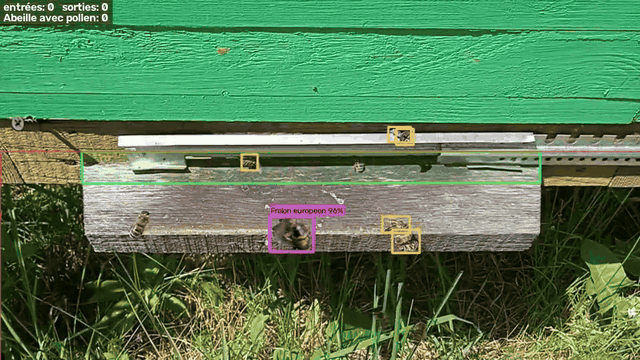
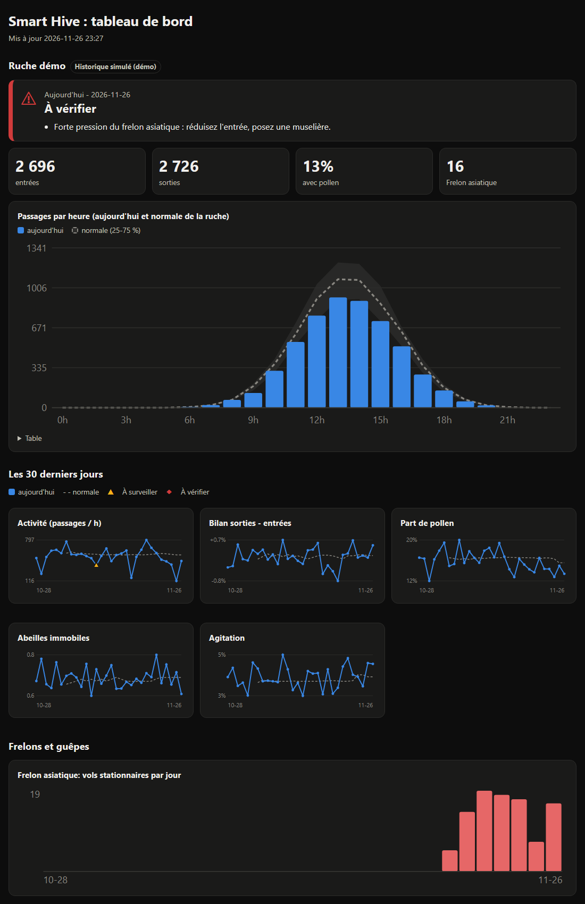
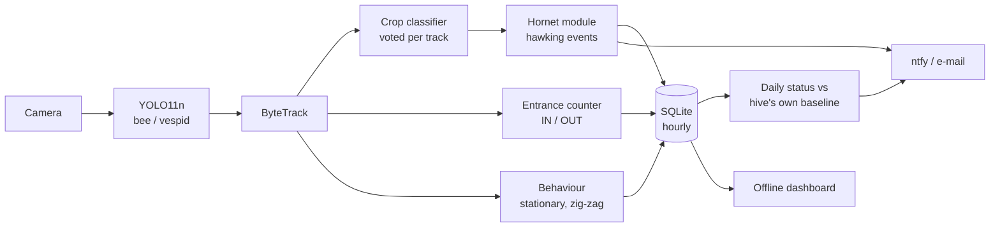

# Smart Hive

**A €150 camera at the hive entrance that tells a beekeeper when to open the hive, and spots
hornets hunting in front of it.**

<p align="center"></p>
<p align="center"><sub>Real entrance footage with a European hornet cut from a CC0 photo and pasted in (a composite: no openly licensed video of a hornet at a hive entrance exists). It is flagged while hovering and logged without an alert, because it is the native species.</sub></p>

Smart Hive watches the landing board with a Raspberry Pi and a webcam. It counts bees going in
and out, measures pollen inflow, crowding and agitation, and compares every day with **that
hive's own normal**. When something drifts it says so in plain words ("very little pollen
coming in: less brood? queen problem?"). When a hornet hovers in front of the entrance
it records the attack with a photo, and for the Asian hornet (*Vespa velutina*) it sends that
photo to the beekeeper's phone. Telling Asian from European hornets at this resolution is still
the weak link (see [Results](#results)). It runs offline, costs
nothing to operate, and installs with one command.

It was built for the author's grandparents' hives in France, where the Asian hornet is now a
major cause of colony losses.

## Quick start (no hardware needed)

```bash
git clone https://github.com/Polluxgnr/smart-hive.git && cd smart-hive
pip install torch --index-url https://download.pytorch.org/whl/cpu && pip install -e ".[video]"
python tools/fetch_weights.py && smart-hive demo
```

`smart-hive demo` runs the full pipeline on the bundled [sample clips](samples/SOURCES.md)
(real entrances, night, rain, an empty board, and hornet composites), writes annotated videos,
simulates a month of history for a hive under hornet pressure, and opens the dashboard.

On a Raspberry Pi: [installation guide (English)](docs/install_en.md) ·
[guide d'installation (français)](docs/install_fr.md).

## What it tells the beekeeper

| Signal | Measured as | A drop or rise may mean |
|---|---|---|
| Activity | bees in + out per hour of daylight | weak colony, queen problem, poisoning (unless cold or rain) |
| Forager balance | (out − in) / (out + in) | foragers not coming back: pesticide, predation |
| Pollen inflow | share of incoming bees carrying pollen | less brood being raised: queen problem, dearth |
| Crowding | bees standing still on the board | heat, congestion, swarm preparation |
| Agitation | share of zig-zag tracks | robbing or fighting |
| Hornet pressure | *V. velutina* hawking events per hour | predation, foraging paralysis |

Each signal is judged against a **robust baseline of the same hive** (median and MAD of the
last 21 normal days), not a fixed threshold: a small colony is not "red" every day, and a
strong colony is flagged when *it* changes. A problem must last two days before the status
says "open this hive". Hornets are the exception: any hovering *V. velutina* is reported.

<p align="center"></p>
<p align="center"><sub>The offline dashboard after <code>smart-hive demo</code>: a simulated month for a hive under Asian-hornet pressure (French interface; English with <code>language: en</code>).</sub></p>

## How it works



* **Detection**: YOLO11n fine-tuned on CPU, two classes (bee, vespid).
* **Tracking**: ByteTrack, so each bee is followed across frames.
* **Species and pollen**: a YOLO11n-cls classifier on 96 px crops (bee, bee with pollen,
  *V. velutina*, *V. crabro*, wasp). Probabilities are averaged over the whole track, so one
  blurry frame cannot raise an alert.
* **Counting**: bees vanish into the entrance slot (IN) or appear from it (OUT); a line rule
  with hysteresis is also available.
* **Hornet behaviour, not presence**: an event needs a vespid track that hovers in a small
  area for 3 s or more. A hornet flying past is ignored. European hornets (native) and wasps
  are logged but do not trigger alerts.

Design rationale and trade-offs: [docs/design.md](docs/design.md).

## Results

Measured on data held out from training (hives never seen, hand-checked crops), on a laptop
CPU. Full method and caveats: [docs/report.md](docs/report.md).

| What | Result |
|---|---|
| Bee detection, 3 hives never seen in training | **mAP50 0.82** (precision 0.84, recall 0.71) |
| Species / pollen classifier, held-out crops | **93.7 % accuracy**; pollen recall 0.93 |
| Hovering hornet found (20 composite clips on test hives) | **18 / 20**, none on 10 clips without an insect |
| Asian-hornet alerts | precision 1.0, recall 0.4 (species is the weak link) |
| False Asian-hornet alerts, 7.3 min of real hornet-free footage | **0** |
| Bees in / out vs manual tracks | 50-93 % of OUT on 4 of 5 videos; IN under-counted; fails on one unseen camera |
| Daily status, 40 simulated colonies x 180 days | **0** false "open this hive" days vs **42** false-alarm days with fixed thresholds |
| Speed (YOLO11n 640 px, PyTorch, laptop CPU) | 120 ms per frame detection; 3-5 analysed frames/s end to end |

What works: detecting bees and hornet *attacks*, and turning noisy counts into a calm daily
status. What does not yet: telling Asian from European hornets at entrance resolution, and
counting on a camera geometry far from the training hives. Both need footage from real hives;
that is the next step.

## Prior work

* **VespAI** (O'Shea-Wheller et al., *Communications Biology* 2024, University of Exeter):
  YOLOv5 on a Raspberry Pi that recognises *V. velutina* and *V. crabro* at a bait station.
* **BeeAlarmed** (GitHub): entrance camera flagging pollen, varroa and wasps.
* **Landing-board dataset** (Sledevič et al., 2023-24) and **VnPollenBee** (2024): the data
  that made this project possible.

Smart Hive does not reuse their code. What it adds is the combination: colony-health signals
judged against each hive's own baseline, hornet *behaviour* rather than presence, and a
one-command install with sample data for people who are not programmers.

## Repository

```
src/smarthive/   the package: counting, health, hornet, pipeline, dashboard, alerts, CLI
tools/           data download, dataset building, training, evaluation, sample generation
tests/           pytest: counting, baseline logic, alerts, hornet events, end-to-end pipeline
samples/         redistributable clips and images, with SOURCES.md
docs/            design, report, install guides (EN/FR)
install/         Raspberry Pi and Windows installers, systemd units
```

```bash
pip install -e ".[dev]" && pytest && ruff check .
```

## Privacy and safety

Everything runs on the device. No data leaves it unless you enable ntfy or e-mail in
`config.yaml`; the SMTP password is read from an environment variable and never stored. The
camera points at the hive entrance, not at people.

## Licence

[AGPL-3.0](LICENSE), because the detector is built on Ultralytics YOLO (AGPL-3.0). Sample
files keep their own licences (CC BY 4.0, CC BY-SA 4.0, CC0), listed in
[samples/SOURCES.md](samples/SOURCES.md).
