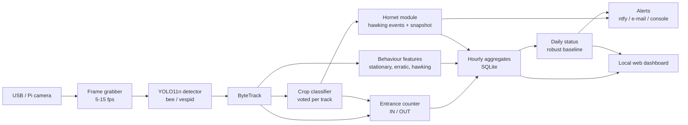

# Smart Hive: design

A cheap camera at the hive entrance that answers two questions for a beekeeper:

1. **Should I open this hive?** A daily *all fine / watch / check this hive* status per hive,
   judged against that hive's own normal, with the reason in plain words.
2. **Are Asian hornets attacking it?** A live alert with a snapshot when *Vespa velutina*
   hovers ("hawks") in front of the entrance, and a count of attacks per hour.

The users are non-technical (the author's grandparents keep hives in France). Everything has
to run on a Raspberry Pi 4/5 or an old laptop, offline, at zero running cost.

## 1. Prior art and what is new here

| Work | What it does | What it does not do |
|---|---|---|
| VespAI (O'Shea-Wheller et al., *Communications Biology* 2024, Univ. of Exeter) | YOLOv5 on a Pi detects *V. velutina* vs *V. crabro* at a bait station, very high precision | Bait station, not a hive entrance; no colony-health signal |
| BeeAlarmed (GitHub) | Entrance camera, flags pollen, varroa, wasps | Per-detection flags, no per-hive baseline, no hornet behaviour |
| Sledevič et al. 2023-24 (landing-board dataset) | Bee detection, direction, behaviour classes | Dataset and models, not a beekeeper tool |
| Bee YOLO11 + ByteTrack (arXiv, 2026) | Detect and track bees at the entrance | Counting only |
| VnPollenBee (Ecol. Informatics 2024) | Pollen-bearing bee detection | Pollen only |

Detection and tracking of bees is solved well enough. The contribution of this project is the
layer on top:

* **Colony-health signals judged against the hive's own history** (rolling median + MAD), so a
  weak colony is not "red" every day and a strong one is flagged when *it* changes.
* **Hornet behaviour, not hornet presence**: a hornet passing by is not an attack; a hornet
  hovering in front of the entrance for seconds is. Events, not frames, drive alerts.
* **One cheap camera, one install command, one dashboard**, with sample data so it can be tried
  without hardware.

No code from VespAI or BeeAlarmed is used.

## 2. System overview

Processes are deliberately simple: one Python process reads the camera, writes hourly rows and
events to SQLite, and regenerates a static HTML dashboard; a tiny built-in HTTP server shows it
on the home network. No database server, no cloud account, no JavaScript build.

## 3. Perception

### 3.1 Detector
* **Model**: Ultralytics YOLO11n (2.6 M parameters), fine-tuned from COCO weights.
  Two classes: `bee` and `vespid` (hornets and wasps). Splitting species is left to the
  classifier because hornet *photos* and hornet *entrance views* look different, and a
  two-stage design lets the detector stay small.
* **Input**: 640 px letterbox. On the landing-board footage a bee is ~20x25 px at that size.
* **Training data**:
  * Bees: landing-board dataset (Sledevič, Mendeley, CC BY 4.0), 8 hives, YOLO boxes.
    A subset of frames is used (disk and CPU budget). **Split by hive**, not by frame: frames
    of one hive are nearly identical, so a frame split would leak and inflate mAP.
  * Vespids: iNaturalist research-grade photos (CC0 / CC BY / CC BY-SA, Europe) of
    *V. velutina*, *V. crabro*, *Vespula*, *Polistes*. They have no boxes; boxes are produced
    once by an open-vocabulary detector (YOLOE with text prompts) and kept only when confident.
    Photos where nothing is found (nests, landscapes, tiny insects) are dropped, which also
    cleans the species data. YOLO-World v2 was tried first and found an insect in only 1-2 of
    20 photos.
  * Copy-paste composites: vespid crops pasted with a feathered mask onto landing-board
    frames, so the detector sees hornets at entrance scale.
* **Deployment**: export to ONNX / OpenVINO (Intel laptops) or NCNN (Raspberry Pi).

### 3.2 Tracker
ByteTrack (the Ultralytics implementation) associates detections, including low-score ones,
which matters for small, blurred bees. Track IDs feed everything downstream.

### 3.3 Crop classifier
YOLO11n-cls on 96 px crops: `bee`, `bee_pollen`, `vespa_velutina`, `vespa_crabro`, `wasp`.
It runs on each track at most every *k* frames and the class probabilities are **averaged over
the track** (track-level vote). One blurred frame cannot raise a hornet alert.
Data: landing-board bee crops, VnPollenBee pollen / non-pollen crops (licence not stated by
the authors, so the data is downloaded by script and never redistributed), iNaturalist
vespid photos split by observation.

## 4. Counting bees in and out

Bees that enter disappear into the entrance slot; bees that leave appear from it. A pure
line-crossing rule misses both when the track starts or ends at the slot. The counter
therefore supports two rules, chosen in the config:

* **`line`**: a directed line (from point A to B; "inside" is on the left). A track is counted
  when its centre moves from more than `margin` px on one side to more than `margin` px on the
  other (hysteresis: jitter on the line does not double count). Each track counts at most once
  per direction change.
* **`zone`** (default for entrances): a polygon around the slot. A track that **ends** inside
  the zone after being seen outside it is IN; a track that **starts** inside the zone and
  **ends** outside is OUT; tracks that start and end outside, or live only inside, are not
  counted (walkers, guards).

Counts are produced when a track ends (lost for `track_buffer` frames), so they are final.

## 5. Colony-health signals

All signals are hourly aggregates stored in SQLite, turned into one value per day.

| Signal | Daily value | Bad direction | Beekeeper meaning |
|---|---|---|---|
| Activity | sum of IN+OUT during daylight | down | weak colony, queen problem, poisoning (unless weather) |
| Forager balance | (OUT - IN) / (OUT + IN) | up | foragers not coming back: pesticide, predation, drift |
| Pollen inflow | pollen-bearing share of IN bees | down | less brood being raised: queen problem, dearth |
| Crowding | mean bees stationary on the board (> 20 s, < 1 body-length net move) | up | bearding: heat, congestion, swarm preparation |
| Agitation | share of bee tracks with erratic, zig-zag motion (mean heading change > 1.2 rad) | up | robbing or fighting at the entrance |
| Hornet pressure | *V. velutina* hawking events | up | predation, foraging paralysis |

### 5.1 Robust baseline
For each signal and hive, the baseline is the **median of the last 21 days** (minimum 5 days
of history; before that the status is *learning*), and the spread is the **MAD** scaled by
1.4826 (consistent with a standard deviation for Gaussian data), floored by a per-signal
minimum so a perfectly flat history does not make tiny changes look huge. The anomaly score
is the robust z-score `z = (x - median) / (1.4826 MAD)`, signed so that positive = bad.

* `z < 2.5`: fine. `2.5 <= z < 3.5`: *watch*. `z >= 3.5`: *check*.
* A *check* that lasts **2 consecutive days** becomes "open this hive" (one bad day is often
  weather).
* Days flagged as anomalous are **not** added to the baseline, so a slow collapse is not
  learned as the new normal.
* Optional weather context (Open-Meteo, free, no key, off by default): a low-activity day
  that is cold (< 12 °C max) or rainy is reported as *quiet (weather)*, not as a problem.

Hornet pressure is the exception: *V. velutina* is an invasive predator, so fixed levels are
used (any hawking event = noted; >= 3 events/hour = *check*, with advice).

## 6. Hornet module

1. A track whose voted class is `vespa_velutina`, `vespa_crabro` or `wasp` is a vespid track.
2. **Hawking** = the track spends at least `hawk_min_seconds` (default 3 s) inside the
   *hawking zone* (the space in front of the entrance) with low net displacement relative to
   its path length (hovering, not passing through).
3. An event is opened when the rule first holds and closed when the track ends. It stores
   species, confidence (track-averaged probability), duration, and a snapshot (frame + box).
4. **Alerts**: only *V. velutina* alerts by default; *V. crabro* (native, protected in some
   regions, less harmful) and wasps are logged and shown, not pushed. A cooldown
   (default 15 min per hive) prevents alert storms.

## 7. Alerts

Channels: `console` (always), `ntfy` (free push to a phone, topic chosen by the user), `email`
(the user's own SMTP; password read from the environment variable
`SMART_HIVE_SMTP_PASSWORD`, never from the config file). Nothing is sent unless a channel is
explicitly enabled in `config.yaml`; `--dry-run` prints what would be sent.

## 8. Dashboard

A static HTML page regenerated every few minutes: today's status per hive with the reason,
traffic chart (today vs baseline band), 30-day signal history, hornet events with snapshots.
Inline SVG, no external JavaScript, so it works offline on the Pi. `smart-hive serve` serves it
on the local network.

## 9. Sample data and simulation

* `samples/`: short clips and images (real entrance footage under CC BY / CC BY-SA, plus
  clearly labelled synthetic variants: night, rain, empty entrance, hornet composites). Every
  file is listed in `samples/SOURCES.md` with its origin and licence.
* `smart-hive simulate`: a generator of realistic hourly aggregates (diurnal traffic curve,
  weather, noise) with scenarios (healthy, forager loss, queen loss, robbing, hornet pressure)
  to test the status logic and alerts without hardware.

## 10. Hardware target and performance budget

* Raspberry Pi 4 (4 GB) or 5, Pi Camera Module 3 or any UVC webcam, fixed 15-25 cm above the
  landing board, looking down.
* Expected throughput (YOLO11n, 640 px): a few fps on a Pi 4 with NCNN, more on a Pi 5; that is
  enough for walking bees on the board but not for fast flyers. Hourly *rates* compared with the
  hive's own baseline tolerate a constant under-count; absolute counts do not.

## 11. What this cannot do (stated up front)

* **Varroa from entrance video is not reliable** at this resolution and frame rate; it is out of
  scope.
* Hornet footage at real hive entrances with an open licence is scarce, so the hornet path is
  trained on photos and composites; real-entrance accuracy must be checked on footage from the
  target hives.
* Counting accuracy depends on camera placement; the entrance zone must be drawn per hive.

## 12. Evaluation plan

* Detection: mAP50 and mAP50-95 on a **held-out hive**.
* Counting: IN/OUT from the full pipeline vs counts obtained by running the same rule on the
  dataset's manually annotated tracks, on held-out hives and two videos of other hives;
  mean absolute error per 30 s window and total relative error.
* Species: precision / recall / confusion matrix on held-out iNaturalist observations.
* Hawking events: precision / recall on synthetic composites with known ground truth; false
  alerts per hour on hornet-free real footage.
* Health logic: false *check* days per simulated year on healthy colonies, detection delay on
  the failure scenarios.
