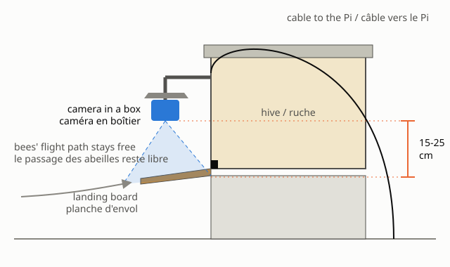
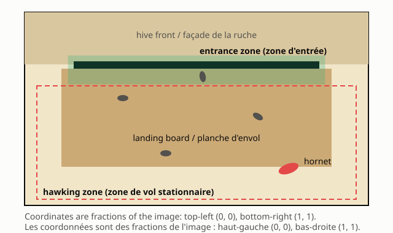

# Smart Hive: installation guide

*Printable guide. About two hours the first time, most of it waiting for downloads.*
*Version française : [install_fr.md](install_fr.md).*

Smart Hive is a small camera above the hive entrance. Each evening it says whether the hive
looks normal **for that hive**, and it sends a phone notification when an Asian hornet hovers
in front of the entrance. It works offline; nothing is sent anywhere unless you turn on
notifications yourself.

---

## 1. What to buy

Rough prices in France, 2026. One camera per hive; one Raspberry Pi can only serve one camera.

| Item | Why | Price |
|---|---|---|
| Raspberry Pi 4 (4 GB) or Pi 5 (4 GB) | the small computer | 60-70 € |
| Official power supply (USB-C, 15 W for Pi 4 / 27 W for Pi 5) | stable power avoids SD-card corruption | 10-14 € |
| microSD card 32 GB, "A1" or "A2" class | the system disk | 8-10 € |
| Camera: USB webcam 1080p **or** Raspberry Pi Camera Module 3 (+ 30 cm flat cable) | the eye | 20-35 € |
| Waterproof box IP65 with a clear lid (about 15 x 10 x 7 cm) for the camera | rain and dust | 10-15 € |
| Waterproof box IP65 (about 20 x 15 x 10 cm) for the Pi, or put the Pi indoors | rain | 10-15 € |
| Aluminium angle or wooden batten, screws, cable ties | the camera arm | 5-10 € |
| Outdoor extension cable + IP44 junction box (if mains power at the apiary) | power | 20-30 € |
| Optional: Pi case with heat sink | keeps the Pi cool in summer | 8-12 € |
| Optional: 4G router or old phone as hotspot | only if there is no Wi-Fi at the hives and you want phone alerts | 0-40 € |

**Total: about 120-180 € per hive.** No subscription, no cloud account.

Without mains power at the apiary: a 12 V 20 Ah LiFePO4 battery, a 30-50 W solar panel, a
charge controller and a 12 V to 5 V 3 A converter run a Pi 4 through a French summer
(a Pi 4 uses 4-6 W). This adds about 120-180 €.

---

## 2. Where to put the camera



* **Above the landing board, looking down**, 15 to 25 cm high. Bees on the board should look
  like grains of rice, not like dots (roughly 30-60 pixels long in the image).
* The **entrance slot** should be in the upper third of the image and the landing board should
  fill most of it.
* **Do not block the flight path.** Bees arrive from the front; the arm comes from the side or
  from above the hive.
* **Shade**: a small roof over the camera box keeps rain drops and direct sun off the window.
  Avoid the sun shining straight into the lens in the morning or evening.
* Fix the arm firmly: if the camera moves, the zones drawn in the config no longer match.



---

## 3. Weatherproofing

* Camera in an IP65 box; the lens touches the clear lid (no reflections). A drop of
  anti-fog spray on the inside of the lid prevents morning condensation.
* Put a **silica-gel bag** in each box; replace it every few months.
* Let every cable enter **from below**, with a **drip loop** (the cable dips lower than the
  box entry, so water drips off instead of running in). Seal the hole with a cable gland.
* **Heat**: the Pi slows down above 80 °C. Keep its box in the shade, white or light grey,
  or indoors with a long USB cable for a webcam (up to 5 m) or a long camera cable.
* Clean the window at each hive visit: propolis, pollen and spider webs blur the image.
* Mains power: the junction box must be IP44 or better and off the ground.

---

## 4. Install the software

### On a Raspberry Pi

1. With **Raspberry Pi Imager** on another computer, write **Raspberry Pi OS (64-bit)** to the
   SD card. In the Imager settings set the Wi-Fi name and password, a user name and password,
   and turn on SSH.
2. Put the card in the Pi, plug the camera and the power, wait 2 minutes.
3. From another computer on the same Wi-Fi, open a terminal and connect:
   `ssh <user>@raspberrypi.local`
4. Run the one-line installer:

   ```bash
   curl -fsSL https://raw.githubusercontent.com/Polluxgnr/smart-hive/main/install/install_pi.sh | bash
   ```

   It installs everything, downloads the trained models and starts two services that restart
   automatically after a power cut: the camera monitor and the dashboard.
5. Open the dashboard from a phone or computer on the same Wi-Fi:
   `http://raspberrypi.local:8080`

### On Windows (to try it, or an old laptop next to the hives)

```powershell
git clone https://github.com/Polluxgnr/smart-hive.git
cd smart-hive
powershell -ExecutionPolicy Bypass -File install\install_windows.ps1
```

This also runs the demo on the bundled sample videos, so you can see the result without
any camera.

---

## 5. Settings (`config.yaml`)

The installer copies `config.example.yaml` to `config.yaml`. Open it with a text editor
(on the Pi: `nano ~/smart-hive/config.yaml`) and change:

* `hive.name`: the name you want to read on the phone, for example `"Ruche du tilleul"`.
* `camera.source`: `0` for a USB webcam, `picamera` for the Raspberry Pi camera.
* `entrance.zone`: the polygon around the entrance slot (see below).
* `entrance.hawk_zone`: optional, the area in front of the entrance where hornets hover.

### Drawing the zones

```bash
cd ~/smart-hive
.venv/bin/smart-hive calibrate --out calibration.jpg
```

This writes `calibration.jpg`: a camera frame with a grid every 10 % and the current zones.
Coordinates are fractions of the image: `[0, 0]` is the top-left corner, `[1, 1]` the
bottom-right. Read the grid and edit the zone so it is a thin band (about one bee long)
covering the entrance slot and the strip of board just in front of it. Re-run `calibrate`
until it looks right, then restart: `sudo systemctl restart smart-hive`.

---

## 6. Phone notifications (optional, free)

Smart Hive uses **ntfy**, a free notification service. No account is needed.

1. Install the **ntfy** app (Android or iPhone).
2. Choose a long, hard-to-guess topic name, for example `ruches-papi-7f3k9q2`.
   Anyone who knows the name can read the messages, so do not use something obvious.
3. In the app, "Subscribe to topic" with that name.
4. In `config.yaml`:

   ```yaml
   alerts:
     ntfy:
       enabled: true
       topic: "ruches-papi-7f3k9q2"
   ```

5. Test it: `.venv/bin/smart-hive test-alert` and restart the service.

**E-mail** instead: fill `alerts.email` with your provider's SMTP server and address. The
password is never written in the file; set it as an environment variable named
`SMART_HIVE_SMTP_PASSWORD` (for the service, add `Environment=SMART_HIVE_SMTP_PASSWORD=...` in
`/etc/systemd/system/smart-hive.service` with `sudo systemctl edit smart-hive`).

What you will receive:

* **Asian hornet** hovering in front of the entrance: immediately, with a photo
  (at most one message every 15 minutes per hive).
* **Daily status** in the evening, only when a hive needs checking.

European hornets (*Vespa crabro*, native) and wasps are shown on the dashboard but do not
trigger notifications.

---

## 7. Reading the dashboard

* **Green - All fine**: nothing unusual compared with this hive's own normal.
* **Yellow - Watch**: one signal is unusual today. Often weather; look again tomorrow.
* **Red - Check this hive**: a strong change. "Open this hive" appears when it has lasted
  two days in a row.
* **Learning**: the first 5 days, while the camera learns what is normal for this hive.

Each status gives the reason in plain words, for example "very little pollen coming in" or
"many foragers are not coming back".

---

## 8. Troubleshooting

| Problem | What to do |
|---|---|
| Dashboard does not open | Same Wi-Fi as the Pi? Try `http://<IP of the Pi>:8080` (shown at the end of the install). |
| No bees counted | Run `calibrate`: is the slot inside the green zone? Is the window clean? |
| Counts look too low | Normal at low frame rate; the status compares with the hive's own normal, so a constant under-count does not matter. Raise `camera.process_fps` on a Pi 5. |
| Many hornet alerts with no hornet | Send the snapshots to the project (they help improve the model) and raise `hornet.hawk_min_seconds` to 5. |
| Service logs | `journalctl -u smart-hive -f` |
| Update | `cd ~/smart-hive && git pull && .venv/bin/pip install -e . && sudo systemctl restart smart-hive` |
