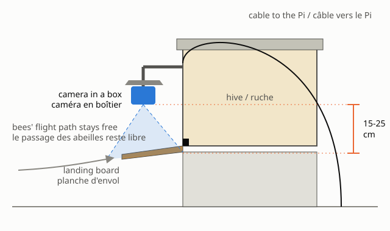
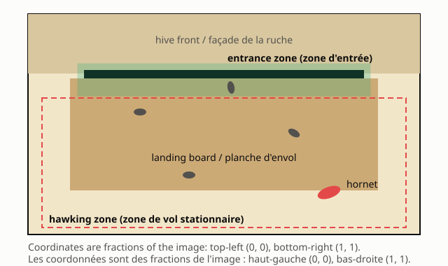

# Smart Hive : guide d'installation

*Guide imprimable. Environ deux heures la première fois, surtout de l'attente de téléchargement.*
*English version: [install_en.md](install_en.md).*

Smart Hive, c'est une petite caméra au-dessus de l'entrée de la ruche. Chaque soir, elle dit si
la ruche se comporte normalement **par rapport à elle-même**, et elle envoie une notification
sur le téléphone quand un frelon asiatique fait du vol stationnaire devant l'entrée. Tout
fonctionne sans Internet ; rien n'est envoyé nulle part tant que vous n'activez pas vous-même
les notifications.

---

## 1. Matériel à acheter

Prix indicatifs en France, 2026. Une caméra par ruche ; un Raspberry Pi ne gère qu'une caméra.

| Élément | Pourquoi | Prix |
|---|---|---|
| Raspberry Pi 4 (4 Go) ou Pi 5 (4 Go) | le petit ordinateur | 60-70 € |
| Alimentation officielle (USB-C, 15 W pour Pi 4 / 27 W pour Pi 5) | une alimentation stable évite d'abîmer la carte SD | 10-14 € |
| Carte microSD 32 Go, classe « A1 » ou « A2 » | le disque du système | 8-10 € |
| Caméra : webcam USB 1080p **ou** Raspberry Pi Camera Module 3 (+ nappe de 30 cm) | l'œil | 20-35 € |
| Boîtier étanche IP65 à couvercle transparent (environ 15 x 10 x 7 cm) pour la caméra | pluie et poussière | 10-15 € |
| Boîtier étanche IP65 (environ 20 x 15 x 10 cm) pour le Pi, ou Pi à l'abri dans un local | pluie | 10-15 € |
| Cornière alu ou tasseau de bois, vis, colliers | le bras de la caméra | 5-10 € |
| Rallonge extérieure + boîte de dérivation IP44 (si courant au rucher) | alimentation | 20-30 € |
| En option : boîtier de Pi avec dissipateur | garde le Pi au frais l'été | 8-12 € |
| En option : routeur 4G ou vieux téléphone en partage de connexion | seulement s'il n'y a pas de Wi-Fi au rucher et que vous voulez les alertes | 0-40 € |

**Total : environ 120 à 180 € par ruche.** Pas d'abonnement, pas de compte en ligne.

Sans courant au rucher : une batterie LiFePO4 12 V 20 Ah, un panneau solaire de 30 à 50 W, un
régulateur de charge et un convertisseur 12 V vers 5 V 3 A font tourner un Pi 4 tout l'été
(un Pi 4 consomme 4 à 6 W). Comptez 120 à 180 € de plus.

---

## 2. Où placer la caméra



* **Au-dessus de la planche d'envol, tournée vers le bas**, à 15-25 cm de hauteur. Sur l'image,
  les abeilles doivent ressembler à des grains de riz, pas à des points (30 à 60 pixels de long).
* La **fente d'entrée** doit être dans le tiers haut de l'image, et la planche doit occuper
  presque toute l'image.
* **Ne gênez pas le passage.** Les abeilles arrivent par l'avant ; le bras vient du côté ou du
  dessus de la ruche.
* **Ombre** : un petit toit au-dessus du boîtier protège la vitre de la pluie et du soleil.
  Évitez le soleil rasant droit dans l'objectif le matin ou le soir.
* Fixez le bras solidement : si la caméra bouge, les zones dessinées dans la configuration ne
  correspondent plus.



---

## 3. Protection contre les intempéries

* Caméra dans un boîtier IP65, l'objectif collé au couvercle transparent (pas de reflets). Une
  goutte d'anti-buée à l'intérieur du couvercle évite la condensation du matin.
* Mettez un **sachet de silica gel** dans chaque boîtier ; changez-le tous les quelques mois.
* Faites entrer chaque câble **par le dessous**, avec une **boucle d'égouttement** (le câble
  descend plus bas que l'entrée du boîtier, l'eau goutte au lieu de rentrer). Fermez le trou
  avec un presse-étoupe.
* **Chaleur** : le Pi ralentit au-dessus de 80 °C. Gardez son boîtier à l'ombre, blanc ou gris
  clair, ou à l'intérieur avec un long câble USB pour une webcam (jusqu'à 5 m).
* Nettoyez la vitre à chaque visite : propolis, pollen et toiles d'araignée rendent l'image floue.
* Sur secteur : boîte de dérivation IP44 au minimum, surélevée par rapport au sol.

---

## 4. Installer le logiciel

### Sur un Raspberry Pi

1. Sur un autre ordinateur, avec **Raspberry Pi Imager**, installez **Raspberry Pi OS (64-bit)**
   sur la carte SD. Dans les réglages d'Imager, indiquez le nom et le mot de passe du Wi-Fi, un
   nom d'utilisateur et un mot de passe, et activez SSH.
2. Mettez la carte dans le Pi, branchez la caméra puis l'alimentation, attendez 2 minutes.
3. Depuis un ordinateur sur le même Wi-Fi, ouvrez un terminal et connectez-vous :
   `ssh <utilisateur>@raspberrypi.local`
4. Lancez l'installation en une ligne :

   ```bash
   curl -fsSL https://raw.githubusercontent.com/Polluxgnr/smart-hive/main/install/install_pi.sh | bash
   ```

   Elle installe tout, télécharge les modèles entraînés et démarre deux services qui
   redémarrent tout seuls après une coupure de courant : la surveillance caméra et le tableau
   de bord.
5. Ouvrez le tableau de bord depuis un téléphone ou un ordinateur sur le même Wi-Fi :
   `http://raspberrypi.local:8080`

### Sous Windows (pour essayer, ou avec un vieux portable près des ruches)

```powershell
git clone https://github.com/Polluxgnr/smart-hive.git
cd smart-hive
powershell -ExecutionPolicy Bypass -File install\install_windows.ps1
```

Le script lance aussi la démonstration sur les vidéos d'exemple fournies : on voit le résultat
sans aucune caméra.

---

## 5. Réglages (`config.yaml`)

L'installation copie `config.example.yaml` en `config.yaml`. Ouvrez-le avec un éditeur de texte
(sur le Pi : `nano ~/smart-hive/config.yaml`) et modifiez :

* `hive.name` : le nom qui apparaîtra sur le téléphone, par exemple `"Ruche du tilleul"`.
* `camera.source` : `0` pour une webcam USB, `picamera` pour la caméra Raspberry Pi.
* `entrance.zone` : le polygone autour de la fente d'entrée (voir ci-dessous).
* `entrance.hawk_zone` : facultatif, l'espace devant l'entrée où les frelons font du surplace.

### Dessiner les zones

```bash
cd ~/smart-hive
.venv/bin/smart-hive calibrate --out calibration.jpg
```

Cela crée `calibration.jpg` : une image de la caméra avec une grille tous les 10 % et les zones
actuelles. Les coordonnées sont des fractions de l'image : `[0, 0]` est le coin en haut à
gauche, `[1, 1]` le coin en bas à droite. Lisez la grille et ajustez la zone pour qu'elle forme
une bande fine (environ une longueur d'abeille) qui couvre la fente et le bord de planche juste
devant. Relancez `calibrate` jusqu'à ce que ce soit bon, puis redémarrez :
`sudo systemctl restart smart-hive`.

---

## 6. Notifications sur le téléphone (facultatif, gratuit)

Smart Hive utilise **ntfy**, un service de notifications gratuit, sans compte.

1. Installez l'application **ntfy** (Android ou iPhone).
2. Choisissez un nom de sujet long et difficile à deviner, par exemple `ruches-papi-7f3k9q2`.
   Toute personne qui connaît ce nom peut lire les messages : évitez un nom évident.
3. Dans l'application, « S'abonner à un sujet » avec ce nom.
4. Dans `config.yaml` :

   ```yaml
   alerts:
     ntfy:
       enabled: true
       topic: "ruches-papi-7f3k9q2"
   ```

5. Testez : `.venv/bin/smart-hive test-alert`, puis redémarrez le service.

**Par e-mail** à la place : remplissez `alerts.email` avec le serveur SMTP et l'adresse de votre
fournisseur. Le mot de passe n'est jamais écrit dans le fichier : il se met dans une variable
d'environnement nommée `SMART_HIVE_SMTP_PASSWORD` (pour le service :
`sudo systemctl edit smart-hive`, puis ajoutez `Environment=SMART_HIVE_SMTP_PASSWORD=...`).

Ce que vous recevrez :

* **Frelon asiatique** en vol stationnaire devant l'entrée : tout de suite, avec une photo
  (au plus un message toutes les 15 minutes par ruche).
* **État du jour** le soir, seulement quand une ruche est à vérifier.

Les frelons européens (*Vespa crabro*, espèce locale) et les guêpes apparaissent sur le tableau
de bord mais ne déclenchent pas de notification.

---

## 7. Lire le tableau de bord

* **Vert - Tout va bien** : rien d'anormal par rapport à l'habitude de cette ruche.
* **Jaune - À surveiller** : un signal est inhabituel aujourd'hui. Souvent la météo ; regardez
  à nouveau demain.
* **Rouge - À vérifier** : un changement net. « Ouvrez cette ruche » s'affiche quand cela dure
  deux jours de suite.
* **Apprentissage** : les 5 premiers jours, le temps que la caméra apprenne ce qui est normal
  pour cette ruche.

Chaque état donne la raison en clair, par exemple « très peu de pollen rapporté » ou
« beaucoup de butineuses ne reviennent pas ».

---

## 8. En cas de problème

| Problème | Que faire |
|---|---|
| Le tableau de bord ne s'ouvre pas | Même Wi-Fi que le Pi ? Essayez `http://<adresse IP du Pi>:8080` (affichée à la fin de l'installation). |
| Aucune abeille comptée | Lancez `calibrate` : la fente est-elle dans la zone verte ? La vitre est-elle propre ? |
| Comptages trop bas | Normal à faible cadence ; l'état compare à l'habitude de la ruche, donc un sous-comptage constant n'a pas d'importance. Sur un Pi 5, augmentez `camera.process_fps`. |
| Beaucoup d'alertes frelon sans frelon | Envoyez les photos au projet (elles aident à améliorer le modèle) et passez `hornet.hawk_min_seconds` à 5. |
| Journal du service | `journalctl -u smart-hive -f` |
| Mise à jour | `cd ~/smart-hive && git pull && .venv/bin/pip install -e . && sudo systemctl restart smart-hive` |
