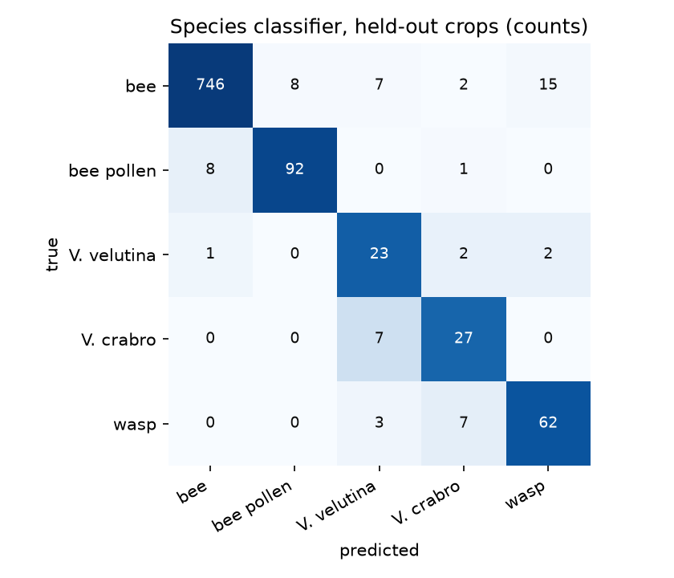
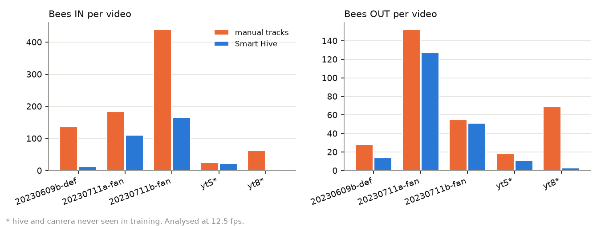
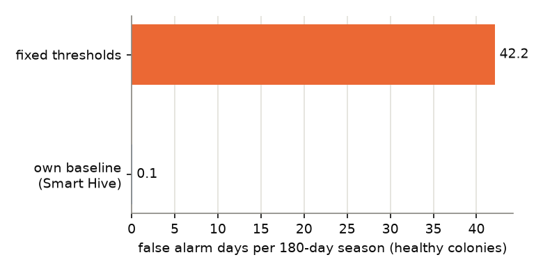

# Smart Hive: evaluation report

Everything below was measured on data held out from training, on a laptop CPU
(Intel i5-1135G7, 8 GB RAM, no GPU). The numbers are what they are: some parts work well,
others clearly need footage from real hives before anyone relies on them. Section 6 says
which.

## Summary

| What | Test data | Result |
|---|---|---|
| Bee detection | 600 frames of **3 hives never seen in training** | **mAP50 0.82**, mAP50-95 0.45 (precision 0.84, recall 0.71) |
| Species and pollen classifier | 1 013 held-out crops, vespid crops checked by hand | **accuracy 93.7 %**; pollen recall 0.93; *V. velutina* precision 0.72 / recall 0.82 |
| Bees in / out | 5 videos with manual tracks (2 from hives and cameras never seen) | good on 2 videos, large under-count of bees going **in** on 3 (section 3) |
| Hornet attacks (hovering) | 40 composite clips on test hives + 7.3 min of real hornet-free footage | **hovering hornet found in 18 of 20 clips**; Asian-hornet alert: precision 1.0, recall 0.4; **0 false alerts** on real footage |
| Daily status logic | 40 simulated colonies x 180 days | **0 false "open this hive" days per season**, against 42 false-alarm days for fixed thresholds; problems flagged in 1-3 days |
| Speed | YOLO11n at 640 px, PyTorch CPU | 120 ms per frame for detection; 3-5 frames per second analysed for the full pipeline |

## 1. Data

| Source | What | Licence | Use |
|---|---|---|---|
| Sledevič et al., landing-board dataset (Mendeley Data, doi:10.17632/8gb9r2yhfc.6) | 1920x1080 frames of 8 hive entrances with YOLO boxes; 5 videos with manually annotated tracks | CC BY 4.0 | bee detection (200 random frames per hive, resized to 1280 px wide), counting evaluation, sample clips |
| iNaturalist research-grade observations, Europe | photos of *Vespa velutina*, *V. crabro*, *Vespula*, *Polistes* (500 each), *Apis mellifera* (150) | CC0 / CC BY / CC BY-SA only | vespid boxes (pseudo-labels), species classification, composites |
| VnPollenBee (Ecological Informatics 2024) | entrance frames with pollen / no-pollen bee boxes (600 of 2 051 images used) | not stated | pollen classifier only; downloaded by script, never redistributed |
| Wikimedia Commons, "Honey bees fanning (1)" | entrance video | CC BY-SA 4.0 | sample clip |

Not used: Kulyukin's BeeVid (no download or licence found), Roboflow Universe hornet sets
(download requires an account and API key), VespAI's training images (not published; the
repository holds weights and code under CC BY-NC-SA / AGPL).

**Boxes for the iNaturalist photos** come from YOLOE (Ultralytics' open-vocabulary detector,
prompts "hornet, wasp, bee, insect"). YOLO-World v2 was tried first and found an insect in
only 1-2 photos out of 20. The score cut (0.08) was chosen by looking at 24 photos; 1 351 of
2 150 photos kept a box. About 15 % of the kept boxes are loose or wrong: acceptable for
training, not for testing, so **every vespid test crop was checked by hand** and 12 of 158
without an identifiable insect of the labelled group were removed
([test_exclusions.json](results/test_exclusions.json)).

### Splits (no leakage)

* **Landing-board frames are split by hive**, not by frame: consecutive frames of one hive
  are near duplicates. Train: hives 20230609a, c, d, e. Validation: 20230711c. **Test:
  20230609b, 20230711a, 20230711b**, which are also the hives of three annotated videos.
* The two other annotated videos (`yt5`, `yt8`) come from **hives and cameras never seen in
  training**.
* iNaturalist photos are split 80/10/10 per species, one photo per observation.

## 2. Models

**Detector**: YOLO11n (2.6 M parameters) fine-tuned from COCO weights, 2 classes (bee,
vespid), 640 px, 6 epochs, backbone frozen, batch 4, on CPU (about 2 hours; the laptop was
shared with another training job). Vespids come from 500 copy-paste composites: insects cut
from iNaturalist photos pasted on training-hive frames at 1.6-2.4x bee size.

One mistake to report: training used Ultralytics' `fraction=0.5` to save time, and that keeps
the *first* half of the file list. Sorted by name, that is every landing-board frame and the
first composites, and **no iNaturalist photo**. The detector therefore never saw close-up
photos, which is why it scores mAP50 0.003 on them (table below). That does not matter for a
camera above a landing board, where insects are small, but a re-run with the full list is the
obvious next step.

| Detection test set | Images | mAP50 | mAP50-95 | Precision | Recall |
|---|---|---|---|---|---|
| Landing boards, 3 unseen hives (bees) | 600 | **0.821** | 0.455 | 0.84 | 0.71 |
| Composites on the 3 unseen hives (vespids) | 125 | 0.945 | 0.698 | 0.82 | 0.93 |
| iNaturalist close-up photos (not in effective training set) | 128 | 0.003 | 0.001 | - | - |

The composite score is optimistic: test composites are made the same way as training ones.

**Classifier**: YOLO11n-cls, 96 px crops, trained in three steps, each prompted by a measured
failure:

1. 10 epochs on photo crops: accuracy 93.8 %, but *V. velutina* precision only 0.58.
2. 6 epochs with half the crops degraded to look like an entrance camera (shrunk to 24-64 px
   and enlarged back, half of those motion-blurred): accuracy 96.4 %, *V. velutina* precision
   0.83. **But on the hornet sample clips the classifier said "bee" on 91-98 % of the hornet
   crops**: it had only ever seen bees on a landing board and hornets on leaves and walls, and
   had learned "board = bee".
3. 5 epochs with 300 crops per vespid group pasted on landing-board patches (training hives
   and training-split donors only). On the hornet clip, crops recognised as hornet/wasp went
   from 4 % to 56 %; on the photo test crops accuracy dropped to 93.7 % and hornet precision
   fell (below). This is the shipped model: what matters is events at a real entrance, and
   step 3 is what makes them happen (section 4).



| Class | Test crops | Precision | Recall |
|---|---|---|---|
| bee | 778 | 0.993 | 0.945 |
| bee with pollen | 101 | 0.922 | 0.931 |
| *Vespa velutina* | 28 | 0.719 | 0.821 |
| *Vespa crabro* | 34 | 0.577 | 0.882 |
| wasp (*Vespula*, *Polistes*) | 72 | 0.770 | 0.931 |

The vespid test sets are small (28-72 crops), so these precisions have wide error bars
(roughly ±0.1).

## 3. Counting bees in and out

The same zone rule (a band along the entrance slot; IN = a track that ends in the band after
being outside it, OUT = the reverse) is applied to the dataset's **manual tracks** and to the
tracks of our pipeline (detector + ByteTrack, 12.5 analysed frames per second). The difference
is the error of detection and tracking, not of the rule.



| Video | Hive seen in training? | IN manual / ours | OUT manual / ours |
|---|---|---|---|
| 20230711a (busy board) | no (test hive) | 183 / 111 (61 %) | 152 / 127 (84 %) |
| 20230711b | no (test hive) | 439 / 166 (38 %) | 55 / 51 (93 %) |
| 20230609b (guards at the slot) | no (test hive) | 137 / 13 (9 %) | 28 / 14 (50 %) |
| yt5 | **never seen, other camera** | 25 / 22 (88 %) | 18 / 11 (61 %) |
| yt8 | **never seen, other camera** | 62 / 2 (3 %) | 69 / 3 (4 %) |

What this says, honestly:

* **OUT is counted reasonably** (50-93 %) wherever the detector works. **IN is under-counted.**
  Part of that is the reference itself: on 20230711b the manual tracks give 439 IN for 55 OUT
  in two minutes, which is not physically plausible. Guard bees that stand still at the slot
  produce many short, fragmented manual tracks, and each fragment that ends in the band counts
  as IN. Our tracker fragments less, so it "misses" these.
* **yt8 is a failure**: a crowded yellow board filmed from further away, bees about 25 px wide
  after resizing. The detector, trained on 4 Lithuanian hives with similar camera geometry,
  does not transfer. This is the main reason the install guide insists on camera placement
  (15-25 cm above the board) and why footage from the target hives is needed.
* For the product this matters less than it looks: the daily status compares each hive with
  **its own** history, so a constant under-count cancels out. A camera that moves, or a change
  of scene (rain, light), does not cancel out.

## 4. Hornet events

Hornets are judged on **behaviour**, not presence: an event needs vespid sightings over at
least 3 s of a 4 s window, within a small area, with movement. A sighting needs the
classifier's track vote (>= 0.6) and either the detector's agreement or a very sure
classifier (>= 0.8). Only *V. velutina* raises an alert.

Getting there took three iterations, each driven by a failure on the sample clips:

1. A per-track rule raised **false events on clusters of bees standing at the slot**
   (classified "wasp" at about 50 %): hovering was not distinguished from sitting.
2. Requiring detector + classifier agreement and movement removed them, but also every real
   hornet: fast flight cut hornet tracks into 1-2 s pieces, none reaching 3 s.
3. The final rule works on **presence over a sliding window**, so fragmented tracks still
   add up.

A fourth problem was in the test data, not the model: the first composite clips scaled the
whole photo box, so the pasted hornet came out the size of a bee. Sprites are now scaled on
their mask to twice a bee's length, like a real *V. velutina*.

### Results

Test clips: 10 s windows of the three **test-hive** videos, with an insect cut (GrabCut) from a
**test-split** iNaturalist photo, either hovering in front of the slot or flying straight
through; 10 clips per case, plus 10 with no insect. The hawking zone starts at the slot, as an
installer would draw it. Then the full pipeline on the five real, hornet-free videos.

| Case (10 clips each) | Clips with an event | Asian-hornet alert | Species of the events |
|---|---|---|---|
| *V. velutina* hovering | **10** | 4 | velutina 5, crabro 3, wasp 2 |
| *V. crabro* hovering | 8 | **0** | crabro 8 |
| Wasp flying through | 3 | 0 | crabro 2, wasp 1 |
| No insect | **0** | 0 | - |
| Real footage, 7.3 min, no hornet | 4 events | **0** | crabro 3, wasp 1 (all on the busiest clip) |

* **Finding a hovering hornet works** (18 of 20 hornet clips, no event without an insect).
* **Telling the species apart does not, yet**: half of the Asian hornets were called European
  hornet or wasp. With alerts limited to *V. velutina*, alert precision is 1.0 but recall 0.4.
* Alerting on *any* hovering hornet would catch 8 of 10 Asian hornets but would also have sent
  3 false alerts during 2 minutes of the busiest real clip. Asian-hornet-only is the default;
  `hornet.alert_species` in the config can widen it, and every event (with its photo) is on the
  dashboard either way.
* 0 false alerts in 7.3 min of real footage is a weak bound (about 25 per hour at 95 %
  confidence). The real test is a season at the target hives.

Composites are not real hornets: the pasted insect has no real wing motion and its lighting
does not match the scene. These numbers say the pipeline works end to end; they do not say
how well it works on a real *V. velutina*.

## 5. Daily status logic

Healthy colonies of different strengths (peak traffic 300 to 2 500 passes per hour) were
simulated for 180 days, with weather; failure scenarios start on day 40 of 60. 40 colonies per
scenario. The simulator is plausible, not measured: these numbers test the decision logic.



| | Smart Hive (own baseline) | Fixed thresholds |
|---|---|---|
| False "check" days per 180-day season, healthy colonies | **0.08** | 42.2 |
| False "open this hive" days per season | **0.0** | - |
| Forager loss: days to "check" / "open this hive" | 2 / 3 | 2 / - |
| Queen loss (pollen inflow falls): days | 2 / 3 | 1 / - |
| Robbing (zig-zag tracks): days | 1 / 2 | 1 / - |
| Swarm preparation (crowding): days | 2 / 3 | 3 / - |
| Asian hornet pressure (fixed level): days | 1 | - |

Fixed thresholds detect problems as fast, but raise an alarm on 42 days of a season for
colonies that are simply weaker or stronger than the threshold assumes. That is the
difference between a tool a beekeeper keeps using and one that gets switched off.

## 6. What still needs real footage from the target hives

* **Hornets at a real entrance.** No openly licensed video of *V. velutina* hawking at a hive
  entrance was found. Detection and species recognition are trained on photos and
  composites, and species recognition is the weak link (section 4). The first season at the grandparents' hives should be run with alerts going to
  the beekeeper's phone *and* the snapshots kept, then the model retrained on them.
* **Counting on the target camera.** The detector does not transfer to every camera geometry
  (yt8). Ten minutes of footage from each installed camera, with a few hundred boxes drawn,
  would fix that far more than any architecture change.
* **Pollen.** Trained on VnPollenBee (Vietnam, *Apis mellifera*, different camera). Pollen
  colours and loads in France differ; the pollen-share signal is relative to each hive's own
  baseline, which helps, but it has not been checked on French footage.
* **Varroa** from entrance video is out of scope: mites are too small at this resolution.

## 7. Reproduce

```bash
python tools/download_landing_board.py --per-hive 200          # ~550 MB, CC BY 4.0
python tools/download_inaturalist.py --per-class 500            # ~200 MB, CC0/CC BY/CC BY-SA
python tools/prepare_pollen.py --max-images 600                 # VnPollenBee, local use only
python tools/pseudo_label_inat.py                               # YOLOE boxes (~1.5 h on CPU)
python tools/build_datasets.py --composites 500
python tools/train.py classifier --epochs 10
python tools/train.py classifier --weights models/classifier.pt --epochs 6 --name classifier_lr
python tools/train.py classifier --weights models/classifier.pt --epochs 5 --name classifier_board
python tools/train.py detector --epochs 6 --batch 4 --fraction 0.5 --freeze 10
python tools/eval_models.py && python tools/eval_counting.py --fps 12.5
python tools/eval_hornet.py --per-kind 10 && python tools/eval_health.py
python tools/make_figures.py
```

Set `YOLO_CONFIG_DIR` to a folder of your own if other projects on the same machine use
Ultralytics: its settings (download and run folders) are global otherwise.
